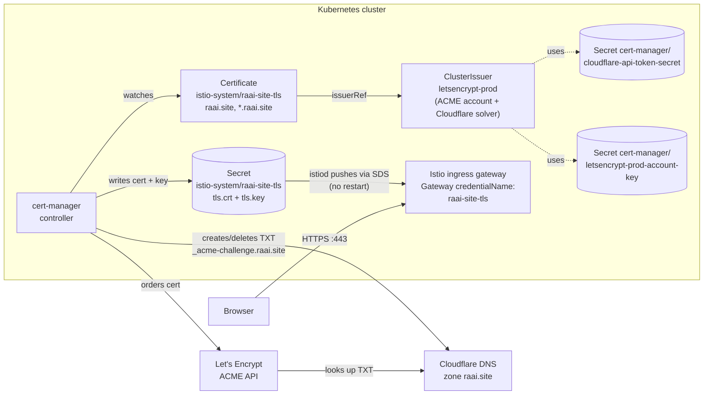
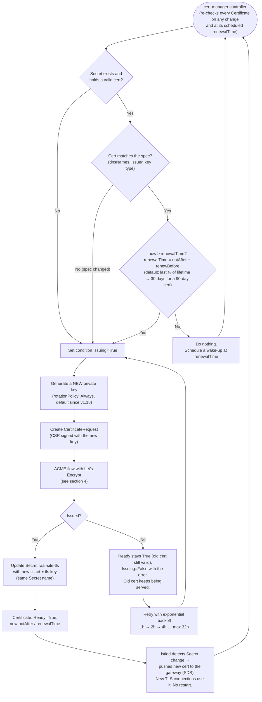
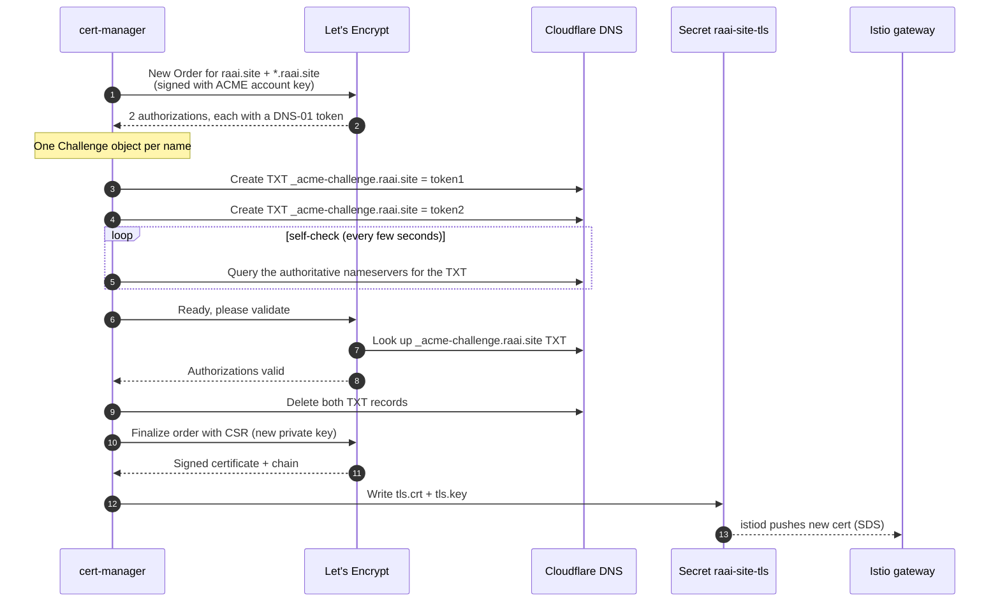
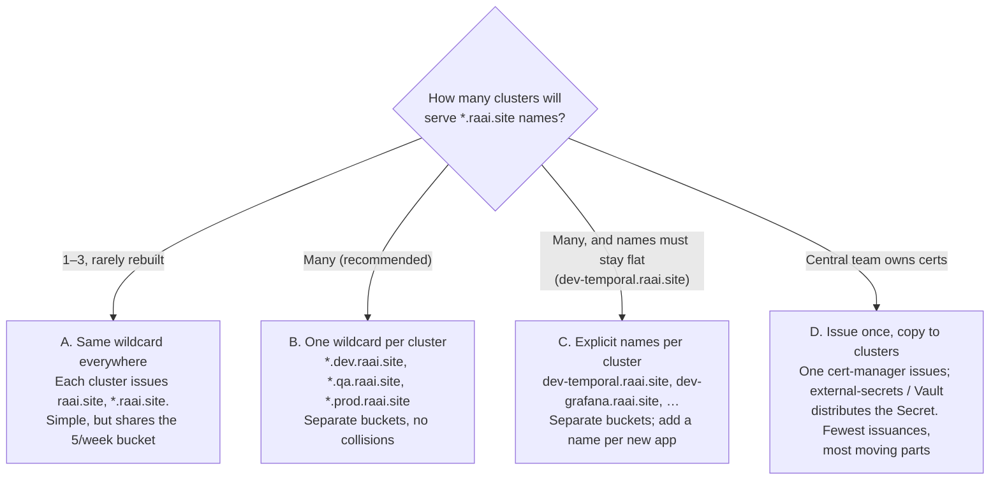

# cert-manager — how certificates are issued and renewed

This explains, end to end, how `https://*.raai.site` gets a trusted certificate and
how it stays valid without anyone touching it, and what to change when the same
setup runs on many clusters.

| Piece | Value on `obs-kind` |
|---|---|
| cert-manager | v1.21.2 (Helm release `cert-manager`, namespace `cert-manager`) |
| Certificate authority | Let's Encrypt (ACME), production + staging |
| Proof of domain ownership | **DNS-01** through the Cloudflare API |
| Certificate | `Certificate istio-system/raai-site-tls` → `raai.site`, `*.raai.site` |
| Where the cert lands | `Secret istio-system/raai-site-tls` (`tls.crt`, `tls.key`) |
| Who serves it | Istio ingress gateway (`credentialName: raai-site-tls` on `observability-gateway`) |

Files in this folder:

| File | Purpose |
|---|---|
| `cluster-issuers.yaml` | `letsencrypt-prod` and `letsencrypt-staging` ClusterIssuers |
| `certificate-raai-site.yaml` | The `*.raai.site` Certificate |
| `monitoring.yaml` | Scrape cert-manager metrics + expiry/failure alerts (VictoriaMetrics) |

---

## 1. Short answer: yes, renewal is automatic

You never renew by hand. cert-manager is a controller: it keeps comparing the
**desired state** (the `Certificate` object: names, issuer, secret) with the
**actual state** (the certificate stored in the Secret). When the stored
certificate gets close to expiry it gets a new one from Let's Encrypt, writes it to
the same Secret, and Istio starts serving it — with no restart and no downtime.

Current certificate (`kubectl -n istio-system get certificate raai-site-tls -o yaml`):

| Field | Value | Meaning |
|---|---|---|
| `notBefore` | 2026-09-23 | Issued |
| `renewalTime` | **2026-11-22** | cert-manager starts renewing on this date |
| `notAfter` | 2026-12-22 | Expires; 30-day safety buffer after `renewalTime` |

---

## 2. The big picture



Why **DNS-01** and not HTTP-01:

- Wildcards (`*.raai.site`) can only be validated with DNS-01.
- Let's Encrypt never needs to reach the cluster. It only reads a public DNS record,
  so this works for clusters that are private, behind NAT, or on a laptop (kind).

---

## 3. The renewal loop (what cert-manager checks, and when)



Key points:

- **Lifetime.** Let's Encrypt decides it (90 days today; `spec.duration` is ignored).
  cert-manager renews when ⅓ of the lifetime is left, so if Let's Encrypt shortens
  lifetimes (it has announced it will), renewal moves earlier automatically.
- **30-day buffer.** A failed renewal doesn't break anything: the old certificate
  stays in the Secret and is served until it really expires. cert-manager keeps
  retrying for up to 30 days. You only get an outage if it fails for the **whole
  30 days**, which is what the alerts in section 7 are for.
- **New key every time.** Each renewal also rotates the private key.
- **Same Secret name.** Anything that references `raai-site-tls` (Istio Gateway)
  picks up the change without editing anything.

---

## 4. One issuance in detail (ACME DNS-01)



Both `raai.site` and `*.raai.site` are validated at the **same** DNS name
(`_acme-challenge.raai.site`), so two TXT values exist there briefly. That's
expected. Typical end-to-end time: 1–3 minutes.

Objects you can watch while it happens:

```
Certificate → CertificateRequest → Order → Challenge (×2)
```

```bash
kubectl -n istio-system get certificate,certificaterequest,order,challenge
```

---

## 5. What each cluster needs

| Object | Namespace | In git? | Notes |
|---|---|---|---|
| cert-manager (Helm, `crds.enabled=true`) | `cert-manager` | command below | |
| `cloudflare-api-token-secret` (key `api-token`) | `cert-manager` | **No** (secret) | ClusterIssuers read secrets from the cert-manager namespace |
| `cluster-issuers.yaml` | cluster-wide | yes | |
| `letsencrypt-*-account-key` | `cert-manager` | **No** (secret) | Created automatically on first use; restore it to reuse the ACME account |
| `certificate-raai-site.yaml` | `istio-system` | yes | Must be in the gateway's namespace: Istio reads `credentialName` from there |
| `monitoring.yaml` | `cert-manager` | yes | |

### Cloudflare API token

Create it in Cloudflare → *My Profile* → *API Tokens* → *Create Custom Token*:

- Permissions: **Zone → DNS → Edit** and **Zone → Zone → Read**
- Zone Resources: **Include → Specific zone → raai.site**
- Use **one token per cluster**. If a cluster is lost or compromised you revoke only
  its token.

### Install on a new cluster

```bash
CTX=kind-obs-kind   # set per cluster

helm repo add jetstack https://charts.jetstack.io && helm repo update
helm --kube-context $CTX upgrade --install cert-manager jetstack/cert-manager \
  --version v1.21.2 -n cert-manager --create-namespace --set crds.enabled=true --wait

# token typed at the prompt, never stored in a file or shell history
read -rsp "Cloudflare API token: " CF_TOKEN; echo
kubectl --context $CTX -n cert-manager create secret generic cloudflare-api-token-secret \
  --from-literal=api-token="$CF_TOKEN"; unset CF_TOKEN

kubectl --context $CTX apply -f cert-manager/cluster-issuers.yaml
kubectl --context $CTX wait clusterissuer --all --for=condition=Ready --timeout=120s

kubectl --context $CTX apply -f cert-manager/certificate-raai-site.yaml
kubectl --context $CTX -n istio-system wait certificate raai-site-tls --for=condition=Ready --timeout=10m

kubectl --context $CTX apply -f cert-manager/monitoring.yaml   # needs the VictoriaMetrics operator
```

### Prove DNS-01 works before you depend on it (staging, no rate-limit cost)

Do this once on every new cluster, or after rotating the Cloudflare token. It runs
the exact renewal path against Let's Encrypt **staging** (untrusted certs, generous
limits):

```bash
cat <<'EOF' | kubectl --context $CTX apply -f -
apiVersion: cert-manager.io/v1
kind: Certificate
metadata: { name: dns01-test, namespace: cert-manager }
spec:
  secretName: dns01-test-tls
  dnsNames: [ "dns01-test.raai.site" ]
  issuerRef: { kind: ClusterIssuer, name: letsencrypt-staging }
EOF
kubectl --context $CTX -n cert-manager wait certificate dns01-test --for=condition=Ready --timeout=5m
kubectl --context $CTX -n cert-manager delete certificate dns01-test
kubectl --context $CTX -n cert-manager delete secret dns01-test-tls
```

`Ready` within a few minutes means the token, the DNS zone and Let's Encrypt all
work, so the real renewal will work too. This hasn't been run on `obs-kind` yet: its
current certificate was **restored** from the minikube backup, not issued here. The
first real DNS-01 run on this cluster will be the renewal on 2026-11-22, so run the
test before then.

---

## 6. Many clusters: what to watch out for

### Let's Encrypt rate limits (the main risk)

| Limit | Value | What it means for us |
|---|---|---|
| Certificates per **exact same set of names** | **5 per 7 days** | Every cluster requesting `raai.site, *.raai.site` counts against the **same** bucket |
| New certificates per registered domain (`raai.site`) | 50 per 7 days | Shared by all clusters; renewals of an existing set are exempt |
| Failed validations | 5 per name, per account, per hour | A broken token on one cluster burns retries quickly |

Check the current numbers at <https://letsencrypt.org/docs/rate-limits/>.

**The trap:** roll out 6 clusters in one week, each with its own cert-manager
requesting `raai.site, *.raai.site`, and the 6th one fails for days. Rebuilding a
cluster without restoring its Secret is another issuance of the same set.

### Pick one of these designs



**Recommendation: B.** Give each cluster its own subdomain and wildcard, for example
`temporal.dev.raai.site` with a Certificate for `*.dev.raai.site`. Each cluster has
its own rate-limit bucket. New apps on that cluster are covered without touching the
Certificate. Clusters can't serve each other's hosts by accident.

A wildcard covers **one** label: `*.raai.site` matches `dev-temporal.raai.site` but
**not** `temporal.dev.raai.site`.

### Per-cluster checklist

- [ ] Own Cloudflare token (scoped to the zone), stored only as a Secret
- [ ] Certificate names chosen per the design above; hostnames in Istio/apps match
- [ ] DNS-01 staging test passed (section 5)
- [ ] `monitoring.yaml` applied, alerts routed somewhere a human sees them
- [ ] Cluster rebuilds **restore** `raai-site-tls` + `letsencrypt-*-account-key`
      before applying the Certificate (section 8), so no new issuance is needed
- [ ] Times in sync (NTP). Large clock skew breaks ACME

---

## 7. Monitoring: don't rely on email

Let's Encrypt **stopped sending expiry-warning emails in 2025**. The `email` on the
ClusterIssuer is only for account notices. You have to watch expiry yourself.

`monitoring.yaml` adds:

- a `VMServiceScrape` for cert-manager's metrics (port `http-metrics`, 9402)
- a `VMRule` with these alerts:

| Alert | Fires when | Meaning |
|---|---|---|
| `CertManagerAbsent` | no cert-manager target up for 10m | Nothing is renewing anything |
| `CertificateNotReady` | a Certificate is not Ready for 15m | Issuance or spec problem |
| `CertificateRenewalOverdue` | < 21 days left (warning) | Renewal (due at 30 days) has failed for 9+ days |
| `CertificateExpiringSoon` | < 7 days left (critical) | Act now |

Useful queries in Grafana (VictoriaMetrics datasource):

```promql
# days until expiry, per certificate
(certmanager_certificate_expiration_timestamp_seconds - time()) / 86400
# days until cert-manager will start renewing
(certmanager_certificate_renewal_timestamp_seconds - time()) / 86400
```

Before this README, cert-manager on `obs-kind` was **not** scraped and had no
alerts.

---

## 8. Operations

```bash
# Status at a glance
kubectl -n istio-system get certificate raai-site-tls \
  -o custom-columns=READY:.status.conditions[0].status,EXPIRES:.status.notAfter,RENEWS:.status.renewalTime

# What the gateway is actually serving
openssl s_client -connect 127.0.0.1:443 -servername dev-temporal.raai.site </dev/null 2>/dev/null \
  | openssl x509 -noout -dates -issuer

# Why is it stuck? (follow the chain down)
kubectl -n istio-system describe certificate raai-site-tls
kubectl -n istio-system get certificaterequest,order,challenge
kubectl -n istio-system describe challenge        # DNS errors show up here
kubectl -n cert-manager logs deploy/cert-manager --since=1h | grep -i raai-site

# Force a renewal now (needs cmctl: https://github.com/cert-manager/cmctl/releases)
cmctl renew -n istio-system raai-site-tls
```

Don't force renewals casually. Each one is a new issuance and counts against the
5-per-week limit for that set of names.

### Backing up and restoring on a rebuild

cert-manager adopts a valid certificate it finds in the Secret instead of requesting
a new one, if the Secret exists **before** the Certificate is created.

```bash
# backup
kubectl -n istio-system get secret raai-site-tls -o yaml > raai-site-tls.yaml
kubectl -n cert-manager get secret letsencrypt-prod-account-key -o yaml > le-prod-account.yaml
```

Restore order on the new cluster:

1. Install cert-manager.
2. Create the Cloudflare token Secret.
3. Restore the account-key Secret.
4. Apply `cluster-issuers.yaml`.
5. Restore the `raai-site-tls` Secret.
6. Apply `certificate-raai-site.yaml`.

Strip `resourceVersion`, `uid`, `creationTimestamp` and `managedFields` from the
backups. Restore them with **`kubectl create -f`**, not `kubectl apply`: `apply`
copies the entire object, private key included, into the
`kubectl.kubernetes.io/last-applied-configuration` annotation. That's what happened
on `obs-kind`. Remove it with:

```bash
kubectl -n istio-system annotate secret raai-site-tls kubectl.kubernetes.io/last-applied-configuration-
```

Keep backups out of git: they contain private keys.

---

## 9. Troubleshooting

| Symptom | Likely cause | Check / fix |
|---|---|---|
| Challenge `pending`, "Cloudflare API error … Authentication error" | Token wrong, expired or missing permissions | Recreate the token (DNS Edit + Zone Read on raai.site), update the Secret |
| Challenge stuck "Waiting for DNS-01 challenge propagation" | TXT not visible at the authoritative nameservers | `dig TXT _acme-challenge.raai.site @<cloudflare-ns>`; check Cloudflare for leftover/locked records |
| Order failed "too many certificates already issued for this exact set" | Duplicate-certificate limit (5/week) | Wait (cert-manager retries with backoff), restore a backed-up Secret, or switch to per-cluster names (section 6) |
| ClusterIssuer not Ready | ACME account registration failed | `kubectl describe clusterissuer letsencrypt-prod`; egress to `acme-v02.api.letsencrypt.org:443` |
| Cert renewed but browser shows old one | Gateway not using the Secret, or wrong namespace | Secret must be in `istio-system`; `istioctl proxy-config secret deploy/istio-ingressgateway -n istio-system` |
| Browser warns "untrusted issuer (STAGING)" | Certificate references `letsencrypt-staging` | Change `issuerRef` to `letsencrypt-prod` (this re-issues) |
